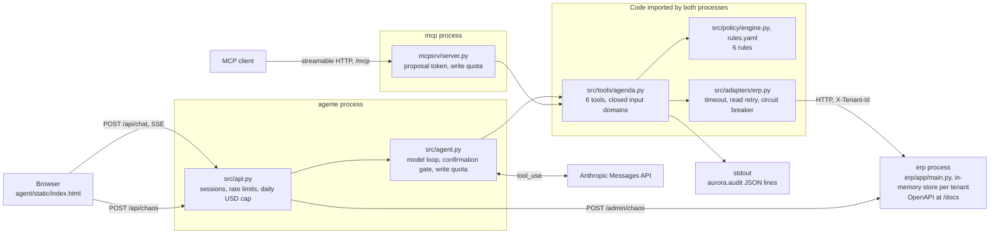

# Clínica Aurora

[](https://github.com/DevPedroGomes/clinica-aurora/actions/workflows/deploy.yml)

A scheduling agent that writes to a separate clinic ERP over HTTP. The clinic, the patients and the ERP are fictional.

Demo: <https://aurora.pgdev.com.br> (Portuguese by default, `?lang=en` for English). ERP API: <https://aurora-erp.pgdev.com.br/docs>. MCP endpoint: `https://aurora.pgdev.com.br/mcp`.

## What this proves

- **The agent writes to another process.** Each write is an HTTP call to a separate FastAPI service, with a 5 s timeout, retries on reads only, and a circuit breaker that opens for 60 s after 3 failures.
- **A deterministic policy engine decides, and the model only phrases.** `agent/src/policy/engine.py` holds six rules as pure functions, with limits from a versioned `rules.yaml`. A refusal reaches the model as a tool error with a phrasing hint, and the write does not run.
- **Every policy decision is logged with a rule code.** The rule code and the rules version appear in the page's decision panel and in a JSON line on the `aurora.audit` logger.
- **A button takes the ERP down.** The ERP then answers 503 for that session, and the tool returns `erp_unavailable`. No tool path produces a confirmation for a write that did not happen. After two consecutive failures the loop escalates the conversation with `tool_failure_repeated`, and `test_erp_fora_do_ar_escala_sem_inventar` covers that path.
- **On the MCP server, each write takes a proposal and a commit.** The first call runs the policy without writing, and returns the refusal or a proposal with a token. The second call, with the token and the same data, writes. A token is single-use and bound to the operation.

Try these in the demo:

| Message | Result |
|---|---|
| Move Ana's appointment to 4pm | A proposal, then the row changes in the ERP panel after your "yes" |
| Move Ana's appointment to Sunday at 10am | `outside_business_hours` in the first reply, with no confirmation asked |
| Cancel João's appointment | `cancel_window_requires_reason` when it is under 24 h away. The seed places it there except from Saturday 10:30 to Sunday 08:00 |
| Book 10 appointments for Marta tomorrow | One proposal. A second booking for her that day gets `patient_daily_limit` |
| Press the button that takes the ERP down, then ask for a change | `erp_unavailable`, and the ERP panel does not change |

## Architecture



A write on the web path goes through these steps:

1. The model calls a write tool.
2. The tool runs in preview mode: ERP reads and the policy, with no write. A refusal stops here with its rule code.
3. If the policy allows it, the gate holds the call and records its signature. The signature becomes confirmable when the turn ends.
4. On the next user message, if the model calls the same operation, the write quota is checked, the policy runs again against the current schedule, and the ERP is written.

The MCP server needs its own process because the MCP SDK requires `starlette>=0.49` and the agent's FastAPI pin requires `<0.42`.

## Run locally

Python 3.12, which is the version CI and the images use.

```bash
make setup
make erp   # ERP on 127.0.0.1:8080, docs at /docs
```

In a second terminal:

```bash
cd agent
ERP_URL=http://127.0.0.1:8080 BUDGET_PATH=/tmp/aurora-budget.json ANTHROPIC_API_KEY=... \
  ../.venv/bin/uvicorn src.api:app --host 127.0.0.1 --port 8000
```

Open <http://localhost:8000>. Without a key, the page and the schedule work and chat turns fail with a logged provider error. The session cookie is `Secure`. This was tested in Chromium on `localhost` and in no other browser.

MCP server, in its own venv because of the dependency conflict above:

```bash
python3 -m venv .venv-mcp && .venv-mcp/bin/pip install -r mcpsrv/requirements.txt
cd mcpsrv
ERP_URL=http://127.0.0.1:8080 MCP_ALLOWED_HOSTS='127.0.0.1:*' \
  ../.venv-mcp/bin/uvicorn server:app --host 127.0.0.1 --port 8091
```

`docker-compose.yml` describes the production deployment. It publishes no ports and expects Traefik on an external `proxy` network, so it does not serve anything on a laptop by itself.

## Tests

```bash
make test   # agent and ERP
make cov    # coverage gates
make lint

.venv-mcp/bin/pip install pytest==8.3.4 pytest-asyncio==0.25.0
cd mcpsrv && ../.venv-mcp/bin/python -m pytest tests -q
```

Measured on this commit:

| Suite | Result |
|---|---|
| `agent/tests` (also covers the ERP) | 393 collected: 389 passed, 4 skipped |
| `mcpsrv/tests` | 21 passed |
| Coverage of `policy/` | 100%, and CI fails below 100% |
| Coverage of `tools/` | 96.7%, and CI fails below 90% |

These suites replace the model with a fake. The 4 skipped tests talk to the real model, cost money, and run only with `ANTHROPIC_API_KEY` and `AURORA_EVAL=1`. They were not run for this count.

CI also runs `ruff` and `mypy --strict` on `policy/` and `tools/`.

## Limits

- **Fictional data, no customers.** The clinic, names and phone numbers are invented. No real clinic has used this.
- **Nothing persists except the spend counter.** Sessions and schedules live in process memory and expire after 2 hours. That keeps the agent on one worker.
- **The ERP button is a per-session switch.** It makes the schedule endpoints answer 503 for that session. The ERP process stays up.
- **The sentence after an ERP failure comes from the model.** The code stops the write and returns an error, and the prompt tells the model to say nothing was saved. No code checks the wording of that reply.
- **The web gate does not read the reply.** It requires a user message between proposal and write, and the same operation signature. Whether a "no" stops the write depends on the model not calling the tool again.
- **The MCP token does not prove a human saw the proposal.** A client can call twice in a row. The policy and the write cap still apply. `mcpsrv/README.md`, in Portuguese, covers this.
- **Out-of-scope refusals are model behaviour.** The `out_of_scope` counter only counts provider refusals, and the `explicit_request` trigger has no caller yet.
- **Escalation has nobody behind it.** It ends the conversation and shows a simulated handoff.
- **There is no login.** `X-Tenant-Id` is the only isolation. The ERP treats a request with no `X-Real-Ip` as internal, which holds only behind the proxy that sets that header.
- **Limits are small on purpose.** 3 writes per conversation, and a daily cap of USD 3 by default, enforced with a reservation before each model call.
- **Comments and prompts are mostly in Portuguese.**

## Dated model and price data

`AGENT_MODEL` defaults to `claude-sonnet-5` and `agent/src/pricing.yaml` was last checked on 2026-08-24. Both stay as they are here because changing them would change the live demo. Against a price list dated 2026-10-06:

- `claude-sonnet-5` has a successor, `claude-sonnet-5-5`. `pricing.yaml` also has `claude-opus-5` and `claude-haiku-4-5`, which have successors `claude-opus-5-5` and `claude-haiku-5-5`.
- `pricing.yaml` prices `claude-sonnet-5` at USD 3 / 15 per million tokens since its promotion ended on 2026-08-31. The price list shows USD 2 / 10, so logged costs may be 50% too high and the daily cap may be reached early.
- `pricing.yaml` has no entry for the successors, and a model with no entry raises an error during cost calculation. Moving `AGENT_MODEL` needs a new entry first.

## License

MIT. See [LICENSE](LICENSE).
